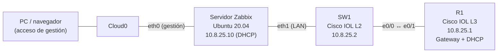
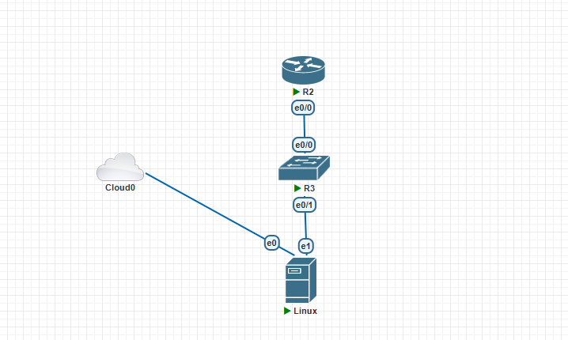
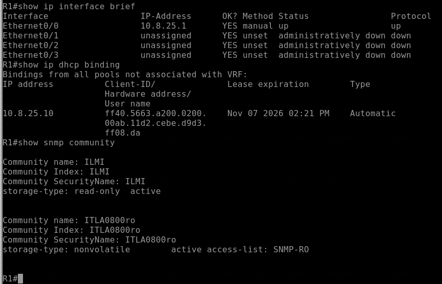
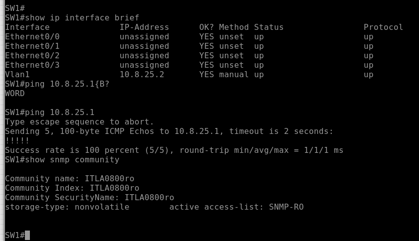
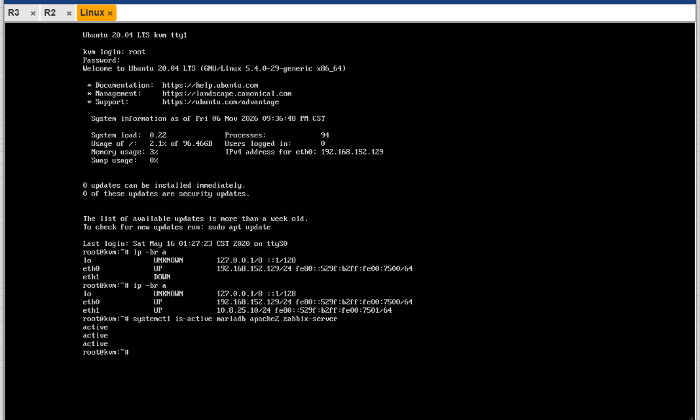
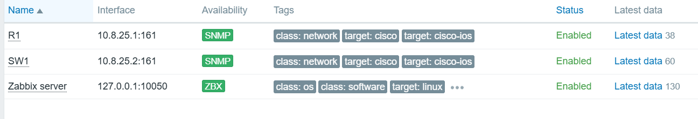
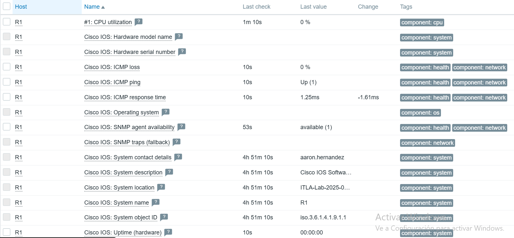
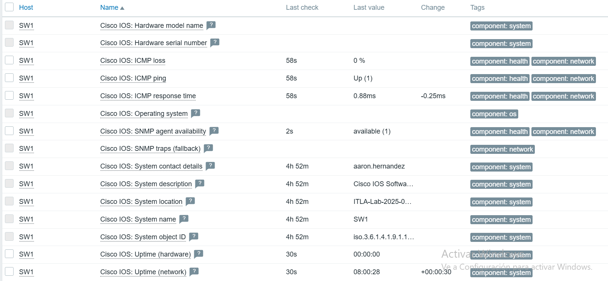

# Monitoreo SNMP con Zabbix: Router, Switch y servidor DHCP

**Estudiante:** Aaron Hernandez | **Matrícula:** 2025-0800 | **Institución:** ITLA
**Asignatura:** Seguridad de Redes | **Tipo:** Asignación individual

## Video demostrativo

> **[▶ Ver el video en YouTube](https://youtu.be/FhgXDAN0Q6E)**
> Duración: menos de 10 minutos, con fecha, hora, rostro y voz.

---

## Propósito del laboratorio

Montar una red LAN pequeña en PNETLab donde un router Cisco actúa como gateway y servidor DHCP, un switch Cisco extiende la LAN, y un servidor Zabbix (cliente DHCP) monitorea ambos equipos por SNMP.

Lo que se demuestra:

- Direccionamiento IP basado en la matrícula (`2025-0800` → red `10.8.25.0/24`).
- Servidor DHCP en el router para la LAN.
- Comunidad SNMP v2c de **solo lectura**, restringida por ACL a la LAN.
- Servidor Zabbix que obtiene su IP por DHCP y recolecta datos SNMP del router y del switch.

El monitoreo es parte de la seguridad de redes: permite ver el estado, la disponibilidad y el tráfico de la infraestructura, y detectar cambios o fallos. Por eso la comunidad es de solo lectura y solo acepta consultas desde la LAN.

---

## Topología





### Conexiones

| Nodo A | Puerto | Nodo B | Puerto |
|---|---|---|---|
| R1 | e0/0 | SW1 | e0/0 |
| SW1 | e0/1 | Zabbix | eth1 (LAN) |
| Zabbix | eth0 | Cloud0 | n/a |

> La tarjeta conectada a **Cloud0** (eth0) es solo de **acceso de gestión**: sirve para instalar paquetes y abrir la web de Zabbix desde el navegador. Todo el monitoreo SNMP viaja por la LAN (eth1).

### Direccionamiento

Red base: `10.8.25.0/24` (derivada de la matrícula 2025-0800).

| Equipo | Interfaz | IP | Asignación |
|---|---|---|---|
| R1 | Ethernet0/0 | 10.8.25.1/24 | Fija (gateway y DHCP) |
| SW1 | VLAN 1 | 10.8.25.2/24 | Fija (gateway 10.8.25.1) |
| Zabbix | eth1 (LAN) | 10.8.25.10/24 | **DHCP** (la entrega R1) |
| Zabbix | eth0 (Cloud0) | 192.168.152.129/24 | DHCP de Cloud0 (solo gestión) |

Pool DHCP: `10.8.25.10` a `10.8.25.200`. Excluidas `.1` a `.9` y `.201` a `.254`. DNS: `8.8.8.8`.

### Equipos e imágenes

| Equipo | Imagen |
|---|---|
| R1 | Cisco IOL L3 |
| SW1 | Cisco IOL L2 |
| Zabbix | Ubuntu Server 20.04 (2 CPU, 3072 MB RAM, 2 interfaces), Zabbix 6.0 LTS |

---

## Configuración

Los archivos completos están en el repositorio:

- Configuración aplicada: [`configs/R1.txt`](configs/R1.txt) y [`configs/SW1.txt`](configs/SW1.txt)
- Running-configs: [`running-configs/R1_running-config.txt`](running-configs/R1_running-config.txt) y [`running-configs/SW1_running-config.txt`](running-configs/SW1_running-config.txt)
- Script de instalación de Zabbix: [`scripts/zbx.sh`](scripts/zbx.sh)

### R1 (router, gateway y DHCP)

```
enable
configure terminal
hostname R1
no ip domain-lookup
ip dhcp excluded-address 10.8.25.1 10.8.25.9
ip dhcp excluded-address 10.8.25.201 10.8.25.254
ip dhcp pool LAN-0800
 network 10.8.25.0 255.255.255.0
 default-router 10.8.25.1
 dns-server 8.8.8.8
interface Ethernet0/0
 description LAN hacia SW1
 ip address 10.8.25.1 255.255.255.0
 no shutdown
ip access-list standard SNMP-RO
 permit 10.8.25.0 0.0.0.255
snmp-server community ITLA0800ro RO SNMP-RO
snmp-server location ITLA-Lab-2025-0800
snmp-server contact aaron.hernandez
line console 0
 logging synchronous
 exec-timeout 0 0
end
write memory
```

### SW1 (switch)

```
enable
configure terminal
hostname SW1
no ip domain-lookup
interface vlan 1
 ip address 10.8.25.2 255.255.255.0
 no shutdown
ip default-gateway 10.8.25.1
ip access-list standard SNMP-RO
 permit 10.8.25.0 0.0.0.255
snmp-server community ITLA0800ro RO SNMP-RO
snmp-server location ITLA-Lab-2025-0800
snmp-server contact aaron.hernandez
line console 0
 logging synchronous
 exec-timeout 0 0
end
write memory
```

### Servidor Zabbix

El servidor se instala con el script [`scripts/zbx.sh`](scripts/zbx.sh), que:

1. Detecta la versión de Ubuntu y elige Zabbix 6.0 LTS (Ubuntu 20.04) o 7.0 LTS (22.04 y 24.04).
2. Identifica las dos tarjetas: la que tiene la ruta por defecto es la de gestión (Cloud0) y la otra es la LAN.
3. Instala MariaDB, el repositorio oficial de Zabbix, el servidor, el frontend con Apache y el agente.
4. Crea la base de datos `zabbix` e importa el esquema inicial.
5. Configura la zona horaria `America/Santo_Domingo`.
6. Configura Netplan con **DHCP en las dos tarjetas** (la LAN sin rutas ni DNS propios, para no pisar la gestión).

Uso:

```bash
sudo bash zbx.sh
```

#### Ajuste manual por la versión de MariaDB

Ubuntu 20.04 trae MariaDB 10.3, y Zabbix 6.0.49 exige 10.5 o superior. El servicio `zabbix-server` quedaba en `activating` y el log decía que la versión de la base de datos no estaba soportada. Para el laboratorio se aplicó:

```bash
echo "AllowUnsupportedDBVersions=1" | sudo tee -a /etc/zabbix/zabbix_server.conf
sudo systemctl restart zabbix-server
```

Por eso el panel *Global view* muestra un aviso de MariaDB no soportada. No afecta al SNMP. Con Ubuntu 22.04 (MariaDB 10.6) no hace falta.

### Hosts en Zabbix

En **Configuration › Hosts › Create host**, para cada equipo:

| Campo | R1 | SW1 |
|---|---|---|
| Host name | R1 | SW1 |
| Template | Cisco IOS by SNMP | Cisco IOS by SNMP |
| Group | Network devices | Network devices |
| Interfaz | SNMP, 10.8.25.1, puerto 161 | SNMP, 10.8.25.2, puerto 161 |
| SNMP version / community | SNMPv2 / ITLA0800ro | SNMPv2 / ITLA0800ro |

---

## Verificación

### Router R1

```
R1# show ip interface brief
R1# show ip dhcp binding
R1# show snmp community
```



R1 entrega `10.8.25.10` al servidor Zabbix, lo que confirma que este actúa como cliente DHCP.

### Switch SW1

```
SW1# show ip interface brief
SW1# ping 10.8.25.1
SW1# show snmp community
```



El primer paquete del ping se pierde por la resolución ARP y los otros cuatro responden.

### Servidor Zabbix (consola)

```bash
date
ip -br a
systemctl is-active mariadb apache2 zabbix-server
zabbix_server -V | head -1
```



`eth1` toma `10.8.25.10/24` por DHCP y los servicios están activos.

### Zabbix (web)

Acceso: `http://<IP de Cloud0>/zabbix`



R1 y SW1 muestran el icono **SNMP** en verde.





Se reciben nombre del sistema, uptime y tráfico de interfaces de ambos equipos.

---

## Notas

- **Host "Zabbix server" con 127.0.0.1:** es el autochequeo del agente interno del propio servidor. Su IP real en la red es `10.8.25.10`.
- **Alerta "Interface Et0/0: In half-duplex mode" en R1:** es una advertencia de nivel *Warning* que aparece porque los equipos IOL son virtuales y reportan el duplex de forma distinta. No afecta la conectividad ni la recolección SNMP.
- **Seguridad:** la comunidad SNMP es de solo lectura (`RO`) y está limitada por ACL a `10.8.25.0/24`. La contraseña de la base de datos y la comunidad son valores de laboratorio sin uso real.

---

## Estructura del repositorio

```
.
├── README.md
├── img/
│   ├── 01-topologia.png
│   ├── 02-r1-verificacion.png
│   ├── 03-sw1-verificacion.png
│   ├── 04-zabbix-consola.png
│   ├── 05-zabbix-hosts.png
│   ├── 06-latest-data-r1.png
│   └── 07-latest-data-sw1.png
├── configs/
│   ├── R1.txt
│   └── SW1.txt
├── running-configs/
│   ├── R1_running-config.txt
│   └── SW1_running-config.txt
└── scripts/
    └── zbx.sh
```